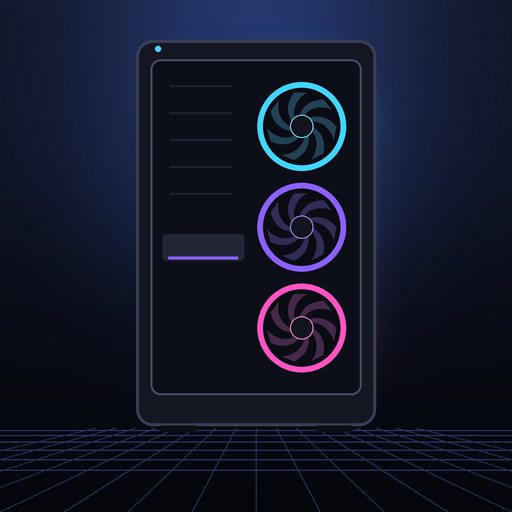

# PC5

<p align="center"></p>

A launcher for your own PC games on a PS5 that runs homebrew. PC5 shows your games as a row
of covers, installs games from a USB drive in one copy each, and uninstalls them with their
saves. It runs the games with [prospero-win](https://github.com/mpereiraesaa/prospero-win)
(Wine on the PS5). The app is `PPSA11018`, its tile is called **PC5**. This is version 1.1.1.

No game is part of PC5, and PC5 downloads none: you install the games you own.

<p align="right">
  <a href="https://www.buymeacoffee.com/bornaradusin">
    
  </a>
</p>

## Using it

1. Copy the `PPSA11018` folder to the console the way you add any homebrew app, and start
   **PC5** from Home. The first time, the library is empty.
2. On a USB drive formatted as **exFAT**, put each game's installed folder (the one with its
   `.exe` in it) at the top of the drive, or in a `Games` folder there. The folder's name
   becomes the game's name in PC5.
3. In PC5 press **Options** › **Install games from USB**. Press **✕** on a folder to
   install that one, after its review screen (the cover PC5 found, the program it will
   start). Or tick several with **□** and press **Options**: PC5 reads them all, finds
   their covers, shows them in a list (✕ reviews one), and installs them one after
   another.
4. Choose the game in the library and press **✕** to play. To leave a game, hold the
   **touchpad** and **Options** for two seconds: the game is asked to close (it can save),
   and if it hasn't after five seconds it is ended. You are back in PC5.

Each game has a menu (**△**): Play, Controller, Change program (when PC5 started the wrong
`.exe`) and Uninstall. Uninstalling deletes the game and everything it made: its saves, its settings,
its shader cache, its cover. There is no backup and no undo. The USB drive is never
written to.

| Buttons | |
| --- | --- |
| ✕ | play, choose (○ if the console is set to confirm with ○) |
| ○ | back |
| △ | the game's menu |
| Left / right, left stick | move between games |
| L1 / R1 | jump to the previous or next letter |
| Options | Settings |
| On the review screen | L1 / R1 other covers, □ another program |
| In a game | touchpad + Options for two seconds: back to PC5 |

A USB keyboard works too: arrows, Enter, Escape, F1 for Settings, F2 for □, F3 for △,
Page Up and Page Down.

## Controller

Each game is played one of three ways, chosen in its menu (**△** › Controller) and kept for
that game:

| Controller | The game sees |
| --- | --- |
| Xbox controller | an Xbox controller (XInput), which most games from the last twenty years look for. The default |
| DualSense | a DualSense plugged in by USB, as on a PC: for games that know the DualSense or look for controllers another way (DirectInput, raw input, SDL). They get the touchpad and the motion sensors too, and their own rumble, light bar and adaptive trigger effects reach the controller |
| Keyboard & mouse | a keyboard and a mouse, for games without controller support. **Button mapping** sets what each button and each stick direction sends (a key, a mouse button or nothing), which stick moves the pointer and how fast; Reset to default gives W A S D on the left stick and the pointer on the right |

A change takes effect the next time the game starts. Holding the touchpad and Options for two
seconds leaves the game whichever is chosen.

## Settings

| | |
| --- | --- |
| Install games from USB | one game, or several in a row |
| Uninstall game | |
| Overlay › Show FPS, Frame time, CPU usage, CPU temperature, SoC temperature, Memory | an overlay over every game, a line each, updated every second: frames shown, their average time (ms), the game's share of the console's CPU, the CPU's and the console chip's temperatures (°C), and the memory the game uses of what it has (GB). FPS alone is the large counter; a line the console can't read is left out |
| Overlay › Corner | where the overlay sits |
| In games › Vibration | how strongly the controller rumbles with the game: off, 25, 50, 75 or 100 % |
| In games › Light bar | the main colour of the game's cover, the colour of what is on screen, or the console's own |
| In games › Adaptive triggers | off; rumble (L2 and R2 vibrate with the game's rumble); resistance (they push back as you press them); or rumble + resistance (they push back, and vibrate while the game rumbles: a trigger runs one effect at a time) |
| In games › Trigger rumble, Trigger resistance | how strongly the triggers vibrate, how firmly they push back: 25, 50, 75 or 100 %; each shows while its effect is on |
| Updates › Check when PC5 opens, Check now | asks GitHub for a newer PC5 (at most once an hour); a newer one is told with the console's notification, once |
| Keep all logs | off: only the logs of sessions that went wrong are kept |
| About PC5 | version, free space |

The light bar and the adaptive triggers follow these settings in every game. With the
DualSense controller, a game that sets its own light bar or trigger effects gets them
instead, from the moment it does.

## What runs

Every game is handled the same way: PC5 reads the game's program to see whether it is 32-
or 64-bit and what it draws with, and writes the same kind of prospero-win profile for it.

| The game uses | Through |
| --- | --- |
| Direct3D 8, 9, 10, 11 | DXVK 2.6.2-prospero2 |
| Direct3D 12 | VKD3D-Proton 2.14.1 |
| Vulkan | RADV directly |
| OpenGL | Mesa Zink |
| DirectDraw / plain Windows drawing | Wine itself |

Only a game whose program draws with Direct3D 12 gets VKD3D-Proton; every other game gets
Wine's own Direct3D 12, as prospero-win's tested profiles have it (a library that only tries
Direct3D 12, as GTA IV's does, stops there instead of going further and crashing).

What won't run: games that need Steam, Epic, EA or Ubisoft's launcher running, online DRM
or anti-cheat; .NET Framework games (prospero-win has no .NET yet); programs that aren't
Windows programs. Whether a game runs is only known by trying it: PC5 makes no promise
about any game. When a game closes before showing anything, or crashes, PC5 says so the
next time it opens, and keeps the log.

**Launch options**: a `launch.txt` beside the game's `.exe` holds its options (its first
line that isn't a `#` comment). PC5 reads it each time the game starts.

**Language**: each game's Windows language is the PS5's, so a game that follows the Windows
language follows the console.

**Covers** come from Steam's store, then GOG's catalogue, then Wikipedia: public sources,
no account and no key. The review screen shows what was found (L1 / R1 for the others). A
game none of them has gets a cover made from its own icon and name. A cover fills its frame
(cut to shape), and the downloaded picture is kept with the game. They are fetched over
HTTPS with Mbed TLS, checked against the console's root certificates and Mozilla's (which
the app carries).

## Where things are

PC5 keeps everything where prospero-win keeps it, in `/data/prospero-win`:

```text
/data/prospero-win/
  profiles/<game>.profile               what prospero-win starts (written by PC5)
  prefixes/<game>/                      the game's own Windows: registry, saves, settings
  prefixes/<game>/drive_c/Games/<folder>/   the one copy of the game
  prefixes/<game>/pc5/                  PC5's notes on the game, its cover and its picture
  prefixes/<game>/pc5-cache/radv/       its shader cache
  pc5/settings.txt                      PC5's settings
  pc5/last.txt, pc5/update.txt          the game played last; the last update check
  logs/issue-<when>_<game>.log          the log of a session that went wrong (kept 7 days)
```

A session's log is written while it runs (`logs/session-N.log`); when PC5 next opens, a
session that went well has its log deleted, and one that went wrong keeps it as
`issue-…`. Nothing in `logs/` is kept longer than seven days.

Games already in `/data/prospero-win` (installed some other way) show up in PC5 too, and get
a cover the first time PC5 opens. An install or uninstall cut short (the console switched
off) is finished, by deleting, the next time PC5 starts.

## Credits and licence

PC5's own code is free software under the GNU LGPL 2.1 or later (`LICENSE`), like
prospero-win. The app as built holds the PS5 boilerplate's startup code and `libc.prx`
(GPL 3.0 or later), so the app as a whole is under the GPL 3.0 or later, as prospero-win's
own release is; its source is `PPSA11018-sources.tar.xz`.

It is built on prospero-win by mpereiraesaa and the projects it uses: Wine, DXVK, Mesa
(RADV, Zink; including mihawk-99's PS5 work), the PS5 payload SDK and boilerplate, and the
Lapy helper. Also VKD3D-Proton (LGPL 2.1 or later), Mbed TLS (Apache 2.0 or GPL 2.0 or
later), Mozilla's root certificates (MPL 2.0), stb_image (public domain / MIT) and the
Inter font (SIL OFL 1.1, `fonts/OFL.txt`). Blur5, sahin and PS5_MihawkOS were inspiration
only; no code was taken from them. See `NOTICE.md`.

PC5 is not made by or connected to Sony, Valve, GOG, GitHub or the Wikimedia Foundation.
